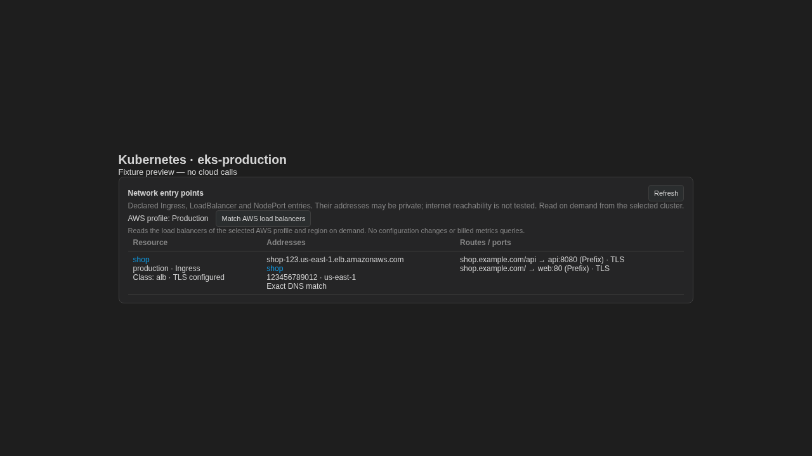

# Kubernetes to AWS load-balancer links

Continuation of #207 after the Kubernetes entry-point inventory in #384.

- After loading Kubernetes entries, the user explicitly requests the load balancers of the selected AWS profile and region through the existing `/api/cloud/aws/elb` route.
- A unique exact normalized DNS match links an Ingress or Service to its AWS resource. ARN account, region and profile travel with the navigation event.
- Similar names, IP addresses, missing/invalid ARNs and multiple matching identities never select a target.
- AWS permissions and partial/truncated inventory are shown independently; Kubernetes remains visible. Changing profile, namespace or context discards old matches and late replies. Refreshing Kubernetes invalidates its matches.
- This does not mutate Kubernetes or AWS configuration, create KUApps membership, start collection, or query billed metrics.

Validation: 131 frontend files / 1487 tests passed, production frontend build passed, whitespace checks passed. Includes exact DNS, account/region/navigation, ambiguity, duplicate identities, namespace isolation, explicit reads, selected profile headers, missing profile, permission failure, stale response and incomplete inventory checks.

Screenshot uses synthetic data. No AWS account was queried for this validation. This covers the AWS linkage part of #207; GCP and Vercel entry-point views still remain, so #207 stays open.
