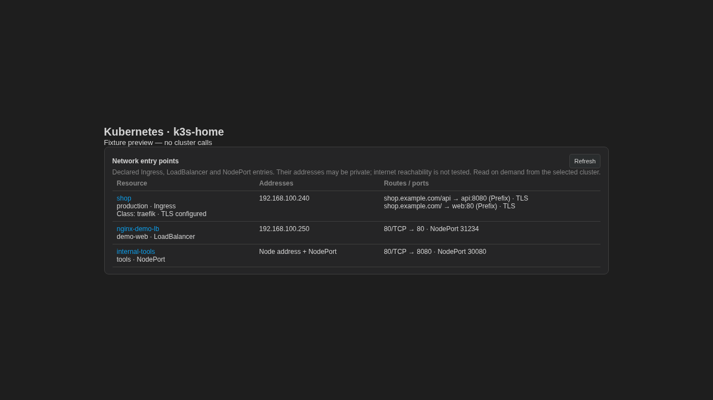

# Kubernetes ticket verification — 2026-11-09

Baseline: GitHub main at `1eef709`. Changes are on `codex/kubernetes-endpoints`.

| Ticket | Verification |
| --- | --- |
| #60 | `selectResource` restores rows per context/namespace/type, then reads silently. Mutation-dependent cache invalidation is present. Store and cache regression suites pass. |
| #61 | Overview endpoint, health summaries, Metrics API / Prometheus fallback, range charts, drill-down and bilingual UI are present. Overview/Prometheus and UI suites pass. |
| #62 | Services uses one namespace Service list plus one EndpointSlice list, not per-service lookups. App and backend columns are present; RBAC degradation is explicit. Backend and frontend suites pass. |
| #89 | Workload log cache, sync, intelligence and query route integration passes with Node 22. Node 26 initially failed because installed SQLite was built for Node 22, not because of a log implementation failure. |
| #95 | Rules and MCP adapter exist, but Overview omitted namespaces and RBAC sources. This change connects them with independent error handling and a collector-to-rule regression test. |
| #280 / #282 | Registry/scope/capability, Kubernetes adapter, resource catalog and collector regression suites pass. This verifies Kubernetes-related code paths, not every AWS/GCP acceptance criterion in these multi-provider tickets. |
| #207 | This PR adds on-demand Kubernetes entry points to Overview and `/api/entrypoints`. It deliberately leaves the ticket open: GCP, Vercel, and cloud load-balancer identity matching remain. |

## Validation

- Complete frontend suite: **130 files, 1479 tests passed**.
- 13 targeted backend test files passed, covering Advisor, security sources, scope/registry/capabilities, catalog/adapter/collector, entry points, overview, services and cache.
- Workload log integration: **5 tests passed**, using Node 22 and a temporary loopback server.
- Production frontend build and `node --check server.js` pass.
- Chromium preview inspected with fixtures; screenshot below is a fixture render, not live cluster data.
- Live read-only check against `k3s-home`: 2 LoadBalancer entries, no Ingress, no failed sources. Namespace metadata (9), ClusterRoleBindings (66), RoleBindings (17) read successfully. Nothing changed in the cluster.

## Limits

The view reads only when requested, and clears after context/namespace changes. It uses two Kubernetes list calls, does not probe addresses and makes no cloud-provider calls. Assigned private IPs, NodePorts and TLS declarations are configuration evidence, not proof of internet reachability or a valid served certificate. RBAC denial is shown independently per source. No Secret values are read. Existing provider dashboards and production services were not restarted.
